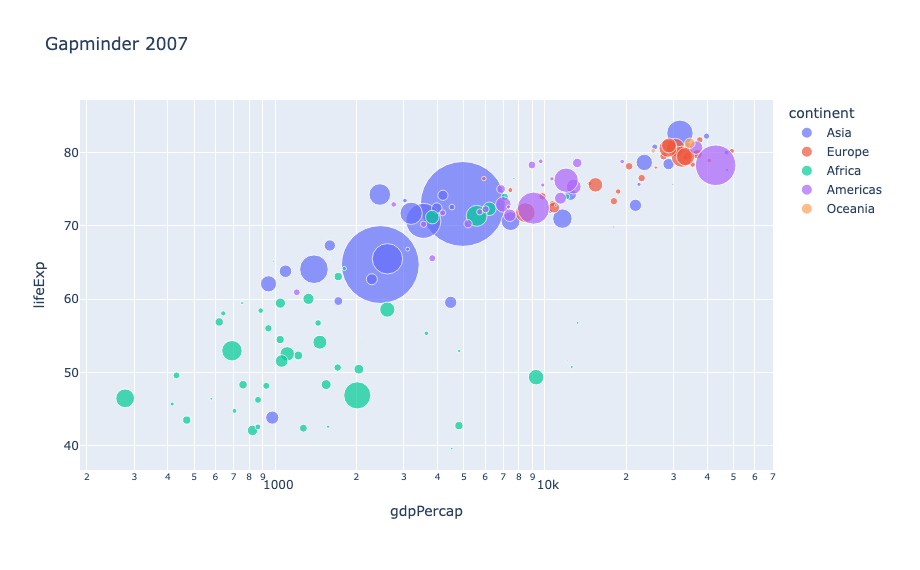

# plotly.express

High-level interactive figures for R: one function call makes a complete
[plotly.js](https://github.com/plotly/plotly.js) figure from a data frame. A
port of [plotly.py](https://github.com/plotly/plotly.py)'s
[Plotly Express](https://plotly.com/python/plotly-express/), built on
[plotly.core](https://github.com/msummersgill/plotly.R.core).

- **All of plotly.py's `px.*` functions** as `px_scatter()`, `px_line()`,
  `px_bar()`, `px_histogram()`, `px_box()`, `px_violin()`, `px_pie()`,
  `px_sunburst()`, `px_treemap()`, `px_scatter_map()`, `px_choropleth()`,
  `px_scatter_3d()`, `px_scatter_polar()`, `px_parallel_coordinates()`,
  `px_imshow()`, ...
- **Mapping columns to colours, symbols, sizes and facets**, marginal plots,
  trendlines (OLS, LOWESS, rolling and expanding windows), animation frames and
  templates, matching plotly.py's output (tested against figures made by
  plotly.py).
- **The `px.data` datasets** (`px_data_gapminder()`, `px_data_iris()`,
  `px_data_tips()`, ...) and plotly.py's colour sequences and scales
  (`px_colors`).
- **Linked views**: a `crosstalk::SharedData` given as `data_frame` links the
  figure's points to other views of the data (see `plotly.core::highlight()`).

Figures are plotly.core `go_figure()` objects: change them with
`update_layout()`, `update_traces()` and the other plotly.core functions, and
render, save or export them as any plotly.core figure.

## Installation

```r
# install.packages("remotes")
remotes::install_github("msummersgill/plotly.R.core")
remotes::install_github("msummersgill/plotly.R.express")
```

## Example

```r
library(plotly.express)

px_data_gapminder(year = 2007) |>
  px_scatter(
    x = ~gdpPercap, y = ~lifeExp, size = ~pop, color = ~continent,
    hover_name = ~country, log_x = TRUE, size_max = 60, title = "Gapminder 2007"
  )
```


